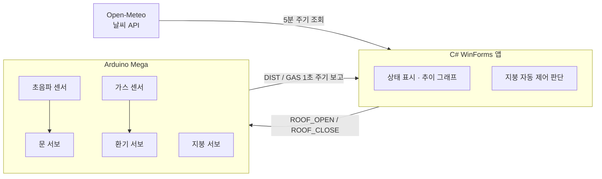

# 🏠 SmartHouseControl

**Arduino + C# WinForms 스마트홈 모형 제어 시스템**

## 📌 소개
센서값을 PC로 실시간 모니터링하고, **날씨 API와 연동해 비가 오면 지붕을 자동으로 닫는** 스마트홈 모형입니다.
Arduino는 센서 판단과 서보 구동을, PC 앱은 모니터링·날씨 판단·원격 명령을 맡습니다.

## 🧩 시스템 구성

## ✨ 주요 기능
**Arduino**
- 🚪 초음파 센서 **20cm 이내 감지 → 문 열림**, 3초간 미감지 시 자동 닫힘
- 💨 가스 센서 **600 이상 → 환기 서보 왕복 구동**, 500 이하로 떨어지면 정지 (히스테리시스)
- 🏠 PC 명령(`ROOF_OPEN` / `ROOF_CLOSE`)으로 지붕 서보 제어
- `millis()` 기반 **논블로킹 루프**로 여러 동작 동시 처리

**PC 앱 (C#)**
- COM 포트 선택·연결, 수신 데이터 파싱 및 실시간 표시
- 센서 **추이 그래프** (`TrendGraph` 커스텀 컨트롤)
- 날씨 API 5분 주기 조회 → **비 오면 지붕 자동 닫힘**
- 지붕 수동 열기/닫기, 장비 없이 시험하는 **데모 모드**

## 🔌 핀 구성
| 핀 | 연결 |
|---|---|
| D6 / D7 | 초음파 TRIG / ECHO |
| D9 | 문 서보 |
| D10 | 지붕 서보 |
| D11 | 환기 서보 |
| A0 | 가스 센서 |

## ▶️ 실행 방법
1. `Arduino_SmartHouse/Arduino_SmartHouse.ino`를 Arduino Mega에 업로드
2. Visual Studio 2022에서 `SmartHouseControl.sln` 열기 → NuGet 복원 → `F5`
3. COM 포트 선택 후 연결 (Arduino IDE 시리얼 모니터는 닫기)
4. 장비 없이 시험할 때는 **[데모 모드]** 체크

자세한 시험 절차: [`START_HERE.txt`](START_HERE.txt), [`HOW_TO_TEST_WEATHER_MOTOR.txt`](HOW_TO_TEST_WEATHER_MOTOR.txt)
